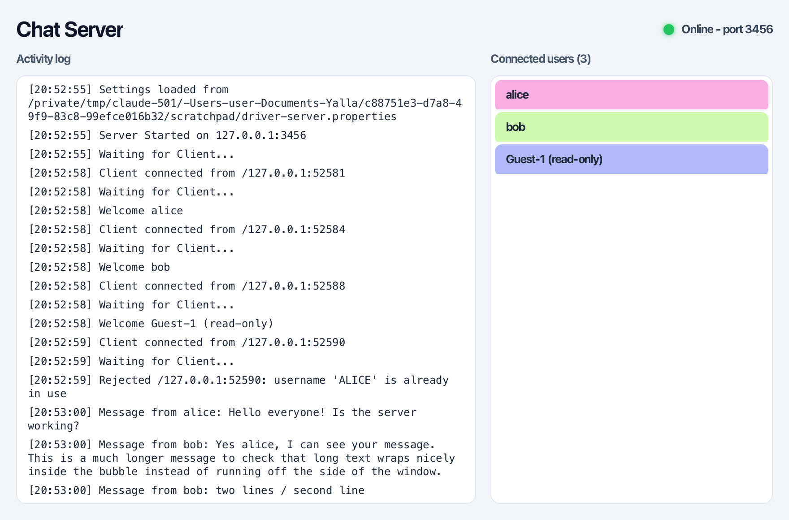
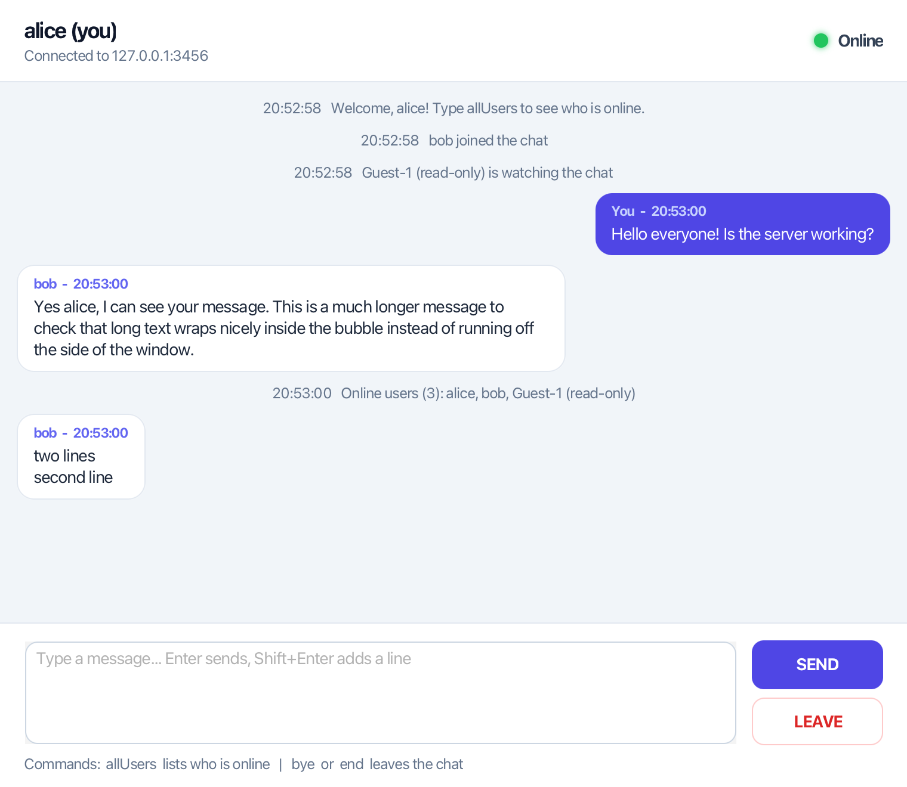
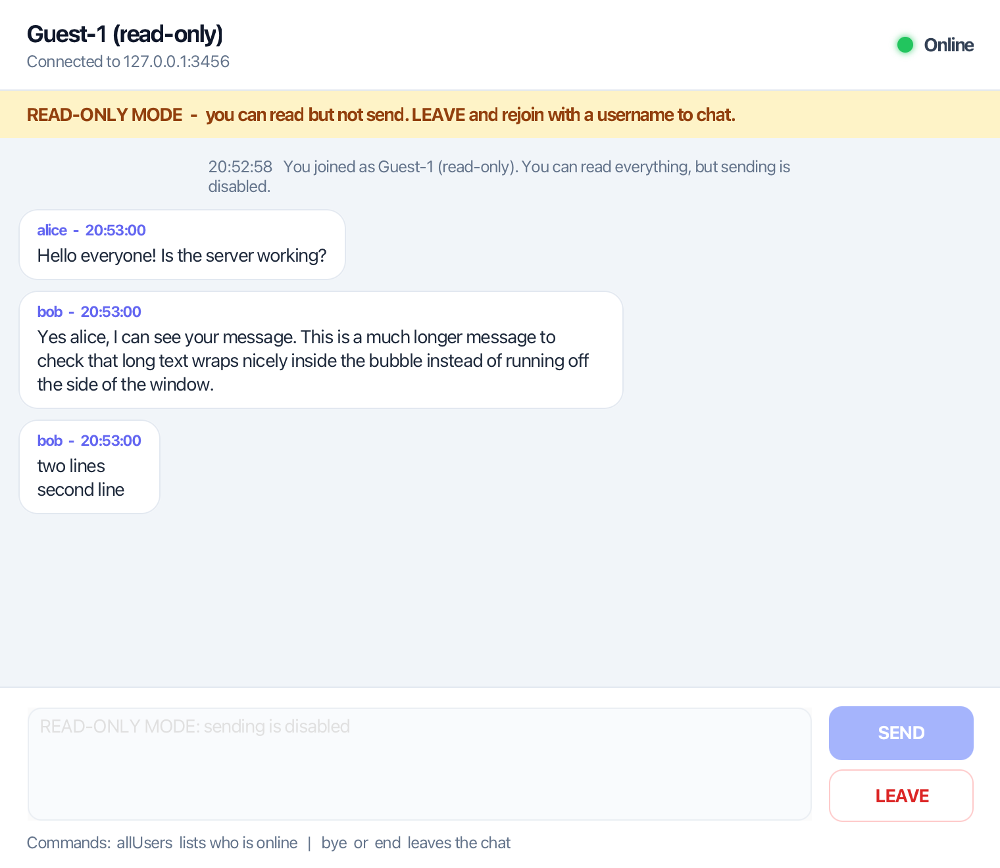
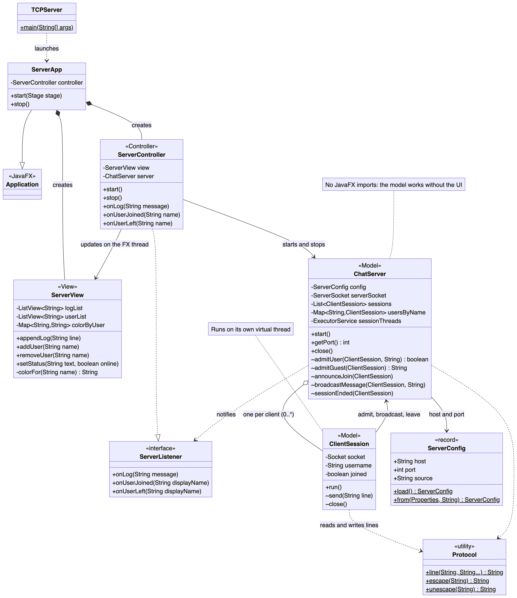
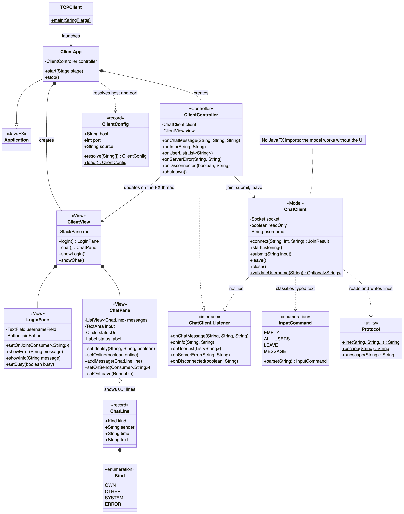
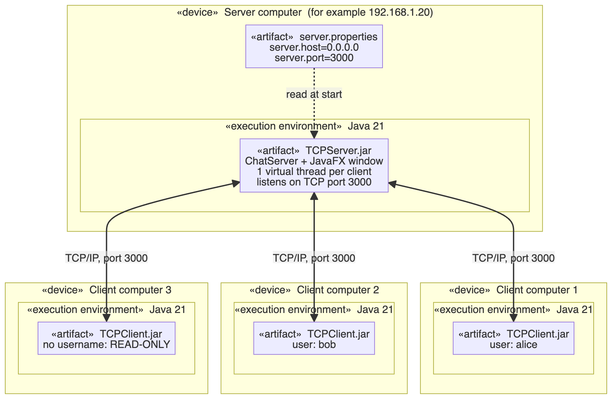
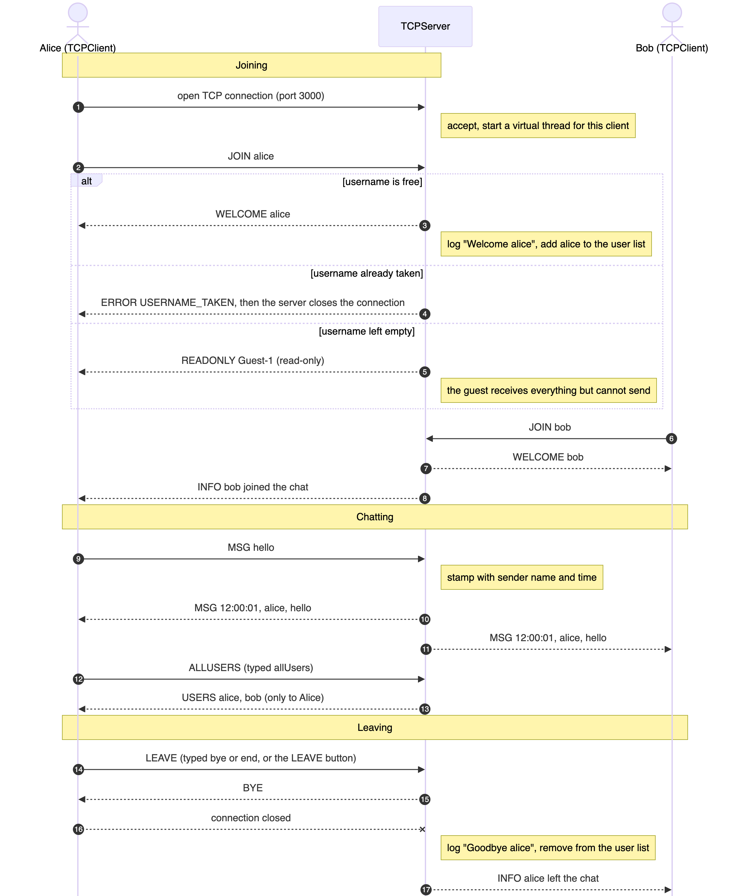

# Multi-Client Chat Application (Java Sockets + JavaFX)

A group chat made of two programs: a **TCPServer** that relays messages, and a **TCPClient** that people use to chat.
Everything talks over plain **TCP sockets**; both programs have a **JavaFX** window.

Mini Project 1 - *Multi-Client Chat Application Using Java Sockets* (course of Prof. El Habib Nfaoui).

| Server | Client |
|---|---|
|  |  |

<details>
<summary>More screenshots (login, read-only mode, error)</summary>

| Login | Read-only mode | Username already taken |
|---|---|---|
|  |  |  |

</details>

## Quick start

You need **Java 21 or newer** (`java -version`). The two runnable JARs are built per operating system (JavaFX contains native code), see [Build](#build-from-source).

```bash
# 1. start the server (port comes from server.properties, default 3000)
java -jar TCPServer.jar

# 2. start as many clients as you like
java -jar TCPClient.jar localhost 3000
```

In the client, type a username and press **Join chat**. Leave the username empty to join in **READ-ONLY MODE**.
To chat from other computers, run the client with the server computer's IP address instead of `localhost`.

| In the message box | What happens |
|---|---|
| any text + `Enter` or **SEND** | sent to everybody (`Shift+Enter` adds a new line) |
| `allUsers` | the server sends *you* the list of online users |
| `bye` / `end` / **LEAVE** button | leaves the chat and closes the connection |

## Requirements checklist

Every point of the assignment and where to find it:

| Requirement | Where it is done |
|---|---|
| Central server distributes messages to all clients | [`ChatServer.broadcastMessage`](TCPServer/src/main/java/chat/server/model/ChatServer.java) |
| Many clients at the same time, **virtual threads** | one virtual thread per client: `Executors.newVirtualThreadPerTaskExecutor()` in [`ChatServer`](TCPServer/src/main/java/chat/server/model/ChatServer.java); the acceptor and the client reader also use `Thread.ofVirtual()`. A test connects 60 clients at once |
| Username before entering the chat | [`LoginPane`](TCPClient/src/main/java/chat/client/view/LoginPane.java); the server checks it (1-20 letters, digits, `_ . -`, unique ignoring case) |
| **READ-ONLY MODE** without a username | server answers `READONLY` and refuses `MSG` from that connection; the client disables the input and shows a banner ([`ChatPane`](TCPClient/src/main/java/chat/client/view/ChatPane.java)) |
| Send with a **SEND** button or Enter | [`ChatPane`](TCPClient/src/main/java/chat/client/view/ChatPane.java) |
| `allUsers` returns the active clients to that user only | [`ClientSession.sendUserList`](TCPServer/src/main/java/chat/server/model/ClientSession.java), tested in `allUsersAnswersOnlyTheAsker` |
| Disconnect with `end`, `bye` or **LEAVE**; connection closed and server notified | [`ChatClient.leave`](TCPClient/src/main/java/chat/client/model/ChatClient.java) sends `LEAVE`; the server logs `Goodbye`, updates the list and tells the others |
| Client shows an **Online** label and a circle | header of [`ChatPane`](TCPClient/src/main/java/chat/client/view/ChatPane.java) (turns red and says *Offline* if the server disappears) |
| Server formats a message with **username and time** | `MSG <time> <sender> <text>` built in [`ChatServer`](TCPServer/src/main/java/chat/server/model/ChatServer.java) |
| Server UI: live **ListView** of connected users | [`ServerView`](TCPServer/src/main/java/chat/server/view/ServerView.java) |
| **Random background colour** per user in that list | `ServerView.colorFor` (random start hue, then golden-angle steps so colours stay distinct) |
| Server **log** ("Server Started", "Waiting for Client", "Welcome [User]") | [`ServerController`](TCPServer/src/main/java/chat/server/controller/ServerController.java) timestamps every line the model reports |
| JavaFX with **GridPane** layout and **CSS** | all screens are built from `GridPane`s; styles in [`server.css`](TCPServer/src/main/resources/server.css) and [`client.css`](TCPClient/src/main/resources/client.css) |
| IP address and port from a **config file**, no recompiling | [`server.properties`](TCPServer/src/main/resources/server.properties), [`client.properties`](TCPClient/src/main/resources/client.properties) (see [Configuration](#configuration)) |
| **Model / View separation** | the `model` packages contain no JavaFX at all; a `controller` package connects them (see [Design](#design)) |
| `java TCPClient <ServerIPAddress> <PortNumber>` / `java TCPServer` | [`TCPClient`](TCPClient/src/main/java/chat/client/TCPClient.java) validates the arguments and prints a usage message; [`TCPServer`](TCPServer/src/main/java/chat/server/TCPServer.java) takes none |
| Maven projects, executable JARs | `TCPServer/` and `TCPClient/` modules; shaded JARs (see [Build](#build-from-source)) |
| UML: class diagram, deployment diagram (+ sequence) | [Diagrams](#uml-diagrams) |

Extras beyond the assignment: duplicate and invalid usernames are rejected with a clear message, multi-line messages, wrapped bubbles, automatic *Offline* handling, and 48 automated tests.

## Design

```
TCPClient / TCPServer   (main)  -> launches the JavaFX application
        |
   Controller  <------ listener interface ------  Model  (sockets, protocol, rules)
        |                                          no JavaFX imports
        v
      View  (GridPane + CSS, no networking)
```

* **Model** (`chat.server.model`, `chat.client.model`): sockets, the protocol, usernames, configuration. It never touches JavaFX. It reports what happens through a small listener interface (`ServerListener`, `ChatClient.Listener`), so a test, a console program or a different GUI could use it unchanged.
* **View** (`chat.*.view`): panes built with `GridPane` and styled with CSS. They only expose methods like `appendLog`, `addMessage`, `setOnline`, and know nothing about sockets.
* **Controller** (`chat.*.controller`): the only place that knows both sides. Model callbacks arrive on background threads, so it hops to the JavaFX thread with `Platform.runLater` before touching the view.

### Threads

The server uses one **virtual thread per client** (cheap, so thousands of idle connections are fine) and one more for accepting connections. The client uses a virtual thread to connect without freezing the window, and one to read what the server sends. Writes to one client are guarded by a `ReentrantLock` because several threads can send to the same client at once.

### Protocol

One line of UTF-8 text per command, fields separated by a TAB. Message text is escaped (`\n`, `\t`, `\\`) so it always fits on one line. You can even chat with `nc localhost 3000`.

| Client to server | Meaning |
|---|---|
| `JOIN <username>` | first line; empty username means read-only |
| `MSG <text>` | a chat message |
| `ALLUSERS` | who is online? |
| `LEAVE` | goodbye |

| Server to client | Meaning |
|---|---|
| `WELCOME <username>` / `READONLY <guestName>` | answer to `JOIN` |
| `ERROR <code> <message>` | e.g. `USERNAME_TAKEN`, `USERNAME_INVALID`, `READ_ONLY` |
| `MSG <time> <sender> <text>` | a chat message, stamped by the server |
| `INFO <time> <text>` | notices such as "bob joined the chat" |
| `USERS <name> <name> ...` | answer to `ALLUSERS` |
| `BYE` | the connection is closing |

The typed commands also work as plain text (`MSG allUsers`, `MSG bye`), so a bare `nc` or `telnet` session behaves like the real client.

## Configuration

Settings live in a `.properties` file, read when the program starts. The program looks for it, in this order:

1. the path in `-Dchat.config=/path/to/file.properties`
2. `server.properties` / `client.properties` in the folder you start it from
3. the copy bundled inside the JAR (defaults)

```properties
# server.properties                      # client.properties
server.host=0.0.0.0                      server.host=localhost
server.port=3000                         server.port=3000
```

On the client, the command-line arguments win over the file: `java -jar TCPClient.jar 192.168.1.20 4000`.

## Build from source

Needs JDK 21 and Maven (or just open the project in IntelliJ IDEA: *File > Open*, pick this folder).

```bash
mvn verify                 # compile, run the 48 tests, build both JARs for THIS computer
java -jar TCPServer/target/TCPServer.jar
java -jar TCPClient/target/TCPClient.jar localhost 3000
```

JavaFX includes native code, so a JAR only runs on the operating system it was built for. To build for another one:

```bash
mvn clean package -DskipTests -Djavafx.platform=win     # also: linux, mac, mac-aarch64
./scripts/build-dist.sh                                  # all platforms into dist/<platform>/
```

## Tests

```bash
mvn test
```

* `ChatServerTest` (17): starts a real server on a free port and talks to it with raw sockets, covering joining, duplicate names, broadcast, `allUsers` only to the asker, read-only guests, `LEAVE`/`bye`/`end`, dropped connections, shutdown, and 60 clients at once.
* `ChatClientTest` (16): tests the client model against a tiny fake server.
* Protocol, configuration and command parsing are unit-tested too.

## Project layout

```
pom.xml                     parent POM (versions, JavaFX per platform)
TCPServer/                  Maven project: the server
  src/main/java/chat/server/{model,view,controller}
  src/main/resources/       server.properties, server.css
TCPClient/                  Maven project: the client
  src/main/java/chat/client/{model,view,controller}
  src/main/resources/       client.properties, client.css
docs/diagrams/              UML sources (.mmd) and images (.svg, .png)
docs/screenshots/           screenshots used in this README
scripts/build-dist.sh       builds the JARs for every operating system
```

## UML diagrams

The sources are Mermaid files (`docs/diagrams/*.mmd`, GitHub draws them natively); images are exported next to them.

**Class diagrams:** [server](docs/diagrams/class-diagram-server.png) and [client](docs/diagrams/class-diagram-client.png)





**Deployment diagram:** the server computer, the client computers and the TCP/IP links



**Sequence diagram:** joining, chatting, `allUsers` and leaving



## Troubleshooting

* **"Can't connect to ... Is the server running?"** Start `TCPServer` first, and check the IP address and port.
* **Other computers cannot connect.** Keep `server.host=0.0.0.0`, and allow Java through the firewall on the server computer.
* **"Address already in use" in the server log.** Another program uses that port; change `server.port`.
* **`WARNING: Unsupported JavaFX configuration: classes were loaded from 'unnamed module'`** is printed by JavaFX when it runs from a single JAR. It is harmless.
* **The JAR does not start on another computer.** Use the JARs built for that operating system (`dist/<platform>/`).

## Author

Hadil Chafik
